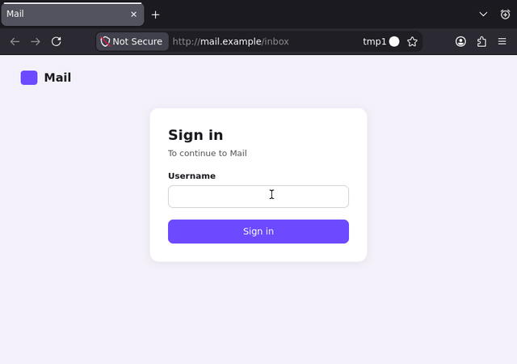
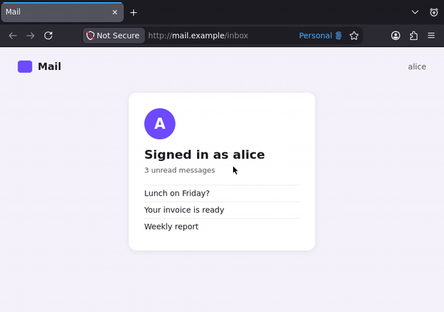
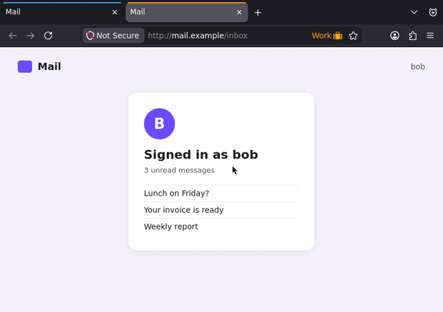
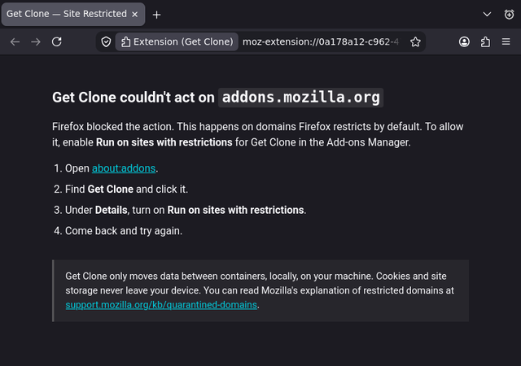

# Get Clone

Clone a tab's session into another container — permanent or temporary — without touching the source tab.

<p align="left">
  get-clone on the Firefox Add-ons Store (coming soon)
  
</p>

---

## Compatibility

Get Clone works with both [*Temporary Containers* on the Mozilla Add-ons Store](https://addons.mozilla.org/en-US/firefox/addon/temporary-containers/) and [*Temporary Containers Plus* on the Mozilla Add-ons Store](https://addons.mozilla.org/en-US/firefox/addon/temporary-containers-plus/).

Without either installed, Get Clone still works — it clones into permanent containers only.

## Usage

<details>
<summary>Clone the active tab into a permanent container</summary>

Right-click the tab → **Clone to Permanent Container** → pick a container. The original tab freezes (discards) once the clone finishes loading.



</details>

<details>
<summary>Clone into a temporary container</summary>

Right-click the tab → **Clone to Temporary Container** (shown in the submenu when TC or TC+ is installed). Pick an existing temporary container, or choose **New Temporary Container** to spin up a fresh one.



</details>

<details>
<summary>Clear site data for this container</summary>

Right-click the tab → **Clone to * Container** → **Clear Site Data for This Container**. Closes every tab in that container matching the domain (subdomains included), then wipes cookies, localStorage, and IndexedDB for those hostnames.



</details>

---

## Security

Get Clone never sends data anywhere. Cookies and site storage move only between containers, locally, on your own machine. Nothing leaves your device.

Restricted domains (those Firefox quarantines by default, such as `addons.mozilla.org`) show the normal menu. If an action fails because the extension lacks access, a help page opens explaining how to enable **Run on sites with restrictions** in `about:addons`.



## Privacy Policy / T.O.S / C.O.C

1. No data is collected. Everything stays local.
2. No terms of service — use as you please. Do respect the [License](./LICENSE).
3. Be kind. This rule is enforced by the repository owner, at their discretion.

---

# Contribution

Test your code before submitting.

## Development build

Using the Nix development shell (recommended):

```bash
nix develop -c npm install
nix develop -c npm run build:firefox
```

Or without Nix (if `node` and `npm` are already installed):

```bash
npm install
npm run build:firefox
```

This writes `dist/*.zip` — the standard WebExtension build artifact.

## Tests

```bash
nix develop -c npm test            # unit tests (Vitest, mocked browser APIs)
nix develop -c npm run test:live   # real Firefox, driven over Marionette
```

The live tests start a throwaway Firefox (vanilla, from nixpkgs) on a private Xvfb display, load `src/` as a temporary add-on, and click real UI with `xdotool`. The site they sign in to is a local fixture, so no network is needed. The Temporary Containers tests also install the signed Temporary Containers `.xpi`, which `nix develop` downloads from addons.mozilla.org (pinned by hash in `flake.nix`). The tests are in `tests/live/`; the harness is [firefox-addon-live](https://github.com/mikenrafter/firefox-addon-live), a flake input that `nix develop` links in as an npm dependency.

## README screenshots and GIFs

```bash
nix develop -c npm run capture:readme                     # every scene
nix develop -c npm run capture:readme -- permanent clear  # only some scenes
```

This rebuilds the add-on, replays each usage scene in a live Firefox with Temporary Containers installed, and writes a PNG still and a GIF per scene to `product-page/` (640 px wide), plus a still of the restricted-site help page. Scenes are in `scripts/capture-readme-assets.ts`.

---

# Technical details

## Menu structure

The primary menu item adapts to the active tab's container type:

- **Active tab is in a permanent container** → primary list shows temporary containers; submenu holds permanent ones.
- **Active tab is in a temporary container** → primary list shows permanent containers; submenu holds temporary ones.
- **No container active** → primary list shows permanent containers (no TC submenu unless TC/TC+ is installed).

The active container is always present but disabled (not hidden). **No Container** is always an option.

**Clear Site Data for This Container** appears at the bottom of the primary menu on every accessible page.

## Failure handling

Every clone and clear action is attempted directly. If the browser rejects it (e.g. the extension lacks host permission on a restricted domain), the extension opens a help page rather than blocking the menu upfront. This means the normal menu always appears — no hardcoded domain lists, no fork-specific assumptions.

## Tab discard

After cloning, the source tab is discarded (Firefox's built-in freeze mechanism) once the new tab reaches `complete` status. The tab stays in the tab strip but releases memory.

## Runtime architecture

- `src/background.ts` — event wiring (menu shown / menu clicked)
- `src/background/menuHandler.ts` — builds and responds to the context menu
- `src/background/cloneRuntime.ts` — cookie copy and tab creation / discard
- `src/background/clearRuntime.ts` — tab removal and browsing data wipe
- `src/background/tcLayer.ts` — Temporary Containers / TC+ detection and proxy
- `src/constants.ts` — shared IDs and privileged-scheme list
- `src/info/restricted-site.html` — help page shown on access failures

---

## Made with ideas from

- [*Temporary Containers* on the Mozilla Add-ons Store](https://addons.mozilla.org/en-US/firefox/addon/temporary-containers/)
- [*Temporary Containers Plus* on the Mozilla Add-ons Store](https://addons.mozilla.org/en-US/firefox/addon/temporary-containers-plus/)
- [*Permanent Containers* on the Mozilla Add-ons Store](https://addons.mozilla.org/en-US/firefox/addon/permanent-containers/)

# License

All code is licensed under the MIT License.  
Because innovation is desirable.
